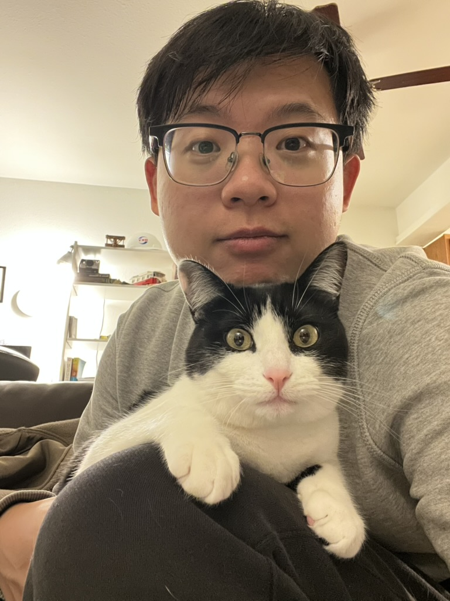

  <h1 class="pb-3 title text-left font-weight-bold">Zijie Gao</h1>
  <h6 class="m-0 mb-2" style="font-size: 0.83em;">{{ page.description }}</h6>
  
      <h6 class="m-0 mb-2" style="font-size: 0.83em;">{{ page.address }}</h6>
  

<!-- Introduction -->

  

  

  I recently completed my PhD in geology at the University of Kansas, advised by Dr. Mike Blum. I am a quantitative sedimentologist, and my work combines detailed core description with new applications of geochronology. My dissertation focuses on the Bengal Fan, Earth's largest submarine fan, built from Himalayan sediment carried by the Ganges and Brahmaputra rivers. In deep-sea cores drilled nearly 1,400 km from the shelf edge, I described more than 1,000 sediment gravity flow deposits bed by bed. Because bed-scale data like these come mostly from confined basins, the dataset offers a baseline for how flows in an unconfined fan partition sand and mud. Among these deposits, rare meters-thick sand beds account for nearly half of the total thickness. Coarse sand has little reason to travel this far, so these beds likely record unusually powerful events. Yet their timing was known only indirectly from the surrounding mud. Using luminescence, a method still rarely applied to deep-sea sediments, I dated the sands themselves and extended direct ages beyond the reach of radiocarbon. These ages now anchor a source-to-sink synthesis that tests how Himalayan climate signals travel to the deep sea, and how much of that history the fan preserves.
  

  

  Alongside my PhD, I completed geology internships at Oxy and Civitas Resources, where I built Python and Spotfire tools that integrate well, seismic, and microseismic data to guide well placement and completion design. I like building things with code, from data workflows in research and industry to small iPhone and Mac apps in my spare time. Now I am looking for roles that bring geoscience and data science together in exploration, energy, climate, or environmental science.
  

<!-- Apps -->


<h1 class="title mb-2 p-0" style="color: var(--global-text-color);">apps I build</h1>

  
  <a class="app-chip" href="{{ '/apps/' | relative_url }}#{{ app.name | slugify }}">
    
    

      
{{ app.name }}

      
{{ app.tagline }}

    

    <i class="fa-solid fa-arrow-right app-chip-arrow"></i>
  </a>
  

<!-- News -->

  <h1 class="title mb-4 p-0" style="color: var(--global-text-color);">news</h1>
  
  
  
  
  
    
    
  
    
  
  
  
    

      

        
          {{ item.date | date: "%b  %Y" }}
        
      

      

        
{{ item.content | remove: '
' | remove: '
' | emojify }}

      

    

  

